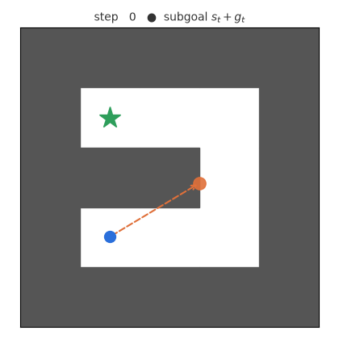

# hiro-pytorch

A step-by-step PyTorch re-implementation of **HIRO** — *Data-Efficient Hierarchical Reinforcement Learning*
(Nachum, Gu, Lee & Levine, NeurIPS 2018, [arXiv:1805.08296](https://arxiv.org/abs/1805.08296)) — written as a course
project to learn the method by building it. Each component was added on its own, with unit tests and a small
experiment, before combining them.



## What is in here

| Component | File | Paper |
|---|---|---|
| DDPG and TD3 (each TD3 fix switchable) | `hiro_pytorch/td3.py` | Eq. 1, refs [12], [27] |
| Goal transition *h*, intrinsic reward, goal-conditioned input | `hiro_pytorch/goals.py` | Eqs. 2–4 |
| Replay buffers (high level stores the c-step state/action sequences) | `hiro_pytorch/buffers.py` | Sec. 3.1 |
| HIRO agent + **off-policy correction** | `hiro_pytorch/hiro.py` | Sec. 3.3, Eq. 5 |
| PointMaze (fast numpy toy maze, our own design) | `hiro_pytorch/envs/maze.py` | — |
| Ant Maze / Ant Push / Ant Fall on the official MuJoCo bindings | `hiro_pytorch/envs/ant_maze.py` | App. B |
| Training scripts | `scripts/train_flat.py`, `scripts/train_low.py`, `scripts/train_hiro.py` | |
| Analysis and figures | `scripts/plot.py`, `viz_goals.py`, `analyze_relabel.py`, `make_gif.py`, … | |
| 27 unit tests | `tests/` | |
| Work report and slides | `docs/report.docx`, `docs/slides.pptx` | |

`plan.md` is the development log: every step, decision and result in the order it happened.

## Results (PointMaze, 200 k steps, 5 seeds)

| Variant | Final success at the end of the maze |
|---|---|
| **HIRO** | **0.91** (5 / 5 seeds solve it) |
| HIRO without off-policy correction | 0.29 |
| Flat TD3 | 0.20 |

The correction mostly rewrites *old* experience: applied to the whole replay buffer with the final low-level policy,
it changes 92 % of the goals in the oldest data and 17 % in the newest (`results/step4_relabel_vs_age.png`).

**Ant tasks:** the environments are ported and tested, but our 2 M-step runs did not learn (the paper trains for
10 M steps; a public re-implementation shows success only after several million). See `docs/report.docx`,
Section 6.1, and the log in `plan.md`. For Ant results we refer to the paper.

## Setup

```bash
conda create -n hiro python=3.12 && conda activate hiro
pip install -r requirements.txt
python -m pytest tests            # 27 tests
```

## Usage

```bash
# TD3 / DDPG sanity check
python scripts/train_flat.py --env Pendulum-v1 --variant td3

# low level alone on random relative goals
python scripts/train_low.py --steps 30000

# HIRO on the PointMaze, with and without the off-policy correction
python scripts/train_hiro.py --env PointMaze --steps 200000 --correction
python scripts/train_hiro.py --env PointMaze --steps 200000

# plots and visualisations
python scripts/plot.py --root results/runs/PointMaze --metric success_0_8,success --out results/success.png
python scripts/viz_goals.py --env PointMaze --ckpt results/checkpoints/PointMaze/hiro/seed0.pt --out results/goals.png

# Ant tasks (slow; `--device cuda` helps on a weak CPU)
python scripts/train_hiro.py --env AntMaze --correction --steps 2000000
```

## Implementation notes

Details we took from the official code that are not in the paper: Huber critic loss; high-level reward
0.1 × Σ env reward; low-level networks see the state with x, y zeroed; correction error normalised by the action
range and candidate σ = 0.5 × goal range; final layers initialised in ±0.003; warm-up with the noisy policies.
The `--legacy` flag reproduces our earlier setup without the last two.

## Credits

- Paper: O. Nachum, S. Gu, H. Lee, S. Levine. *Data-Efficient Hierarchical Reinforcement Learning.* NeurIPS 2018.
- Official TensorFlow code: [tensorflow/models/research/efficient-hrl](https://github.com/tensorflow/models/tree/master/research/efficient-hrl)
  (Apache-2.0). `hiro_pytorch/envs/assets/ant.xml` and the maze layouts are taken from it.
- TD3: S. Fujimoto, H. van Hoof, D. Meger. ICML 2018. DDPG: T. Lillicrap et al. ICLR 2016.
